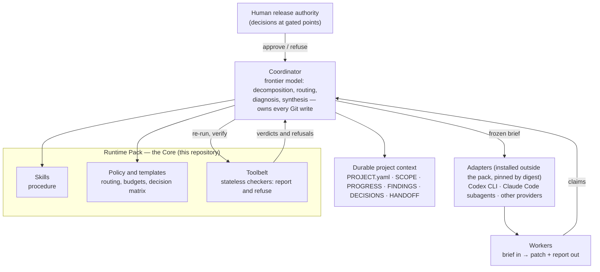

# AI Engineering Harness — Runtime Pack

**A custom, evidence-driven multi-agent engineering harness for orchestrating AI coding agents, enforcing
verification gates, and managing reproducible software delivery.**

Runtime Pack is the versioned core of this harness: the procedures, durable records and stateless Python checkers that
let one frontier-model *coordinator* delegate real software work to several AI coding agents — Claude Code
subagents, the OpenAI Codex CLI and other providers reached through adapters — while keeping every claim checkable.
A worker's report is treated as a claim until the coordinator re-runs it; releases are frozen and pinned by version,
revision and tree digest; Git is read through a boundary that refuses to execute anything the repository under
inspection controls; and nothing private is allowed into a published history.

It was designed and directed by one engineer, with the implementation carried out by AI coding agents (a coordinator
model and the workers it dispatches) operating under the pack's own rules. The history runs from 2026-08-13 to
2026-09-20: 270 historical commits, five qualified releases up to **2.5.0**, and a paused **2.6.0**
development line.

| | |
|---|---|
| **Latest stable release** | **2.5.0** — `QUALIFIED_AND_FROZEN` on 2026-09-10 · branch `stable/2.5.0` |
| **Development** | **2.6.0** — `IN_PROGRESS`, paused at a checkpoint on 2026-09-20 · branch `main` · not qualified, not adoptable |
| **Default branch** | `main` is **development HEAD** (2.6.0, `IN_PROGRESS`); the latest stable release, 2.5.0, is on `stable/2.5.0` |

> **About this public edition.** This repository is a reviewed, sanitized publication of the private development
> history, with every historical commit's original author name, date, time and time zone preserved (the email shown
> is the author's GitHub noreply address). Names of other private
> projects are replaced by neutral pseudonyms (`consumer-a` …), records about those projects keep only what the pack
> did with them and, in general terms, the risks they exposed, and some operational details (account capacity, plan
> and billing specifics) are generalised; the commit messages were normalised to one convention. Because the history
> was rewritten, **commit ids and release tree digests quoted inside historical records refer to the private
> repository and do not resolve here**, and this edition is not byte-identical to the private frozen releases. The
> details are in [`.github/PUBLIC_EDITION.md`](PUBLIC_EDITION.md).

**Status vocabulary used below.** **SHIPPED** — part of a qualified release. **QUALIFIED_AND_FROZEN** — a release
qualified by its gate and frozen by a recorded human decision; it never changes again. **IN_PROGRESS** — development
work, not qualified, not to be pinned. **PLANNED** — recorded as a candidate with the evidence that would trigger it;
not a commitment.

---

## Contents

1. [Overview and motivation](#1-overview-and-motivation) · 2. [Main capabilities](#2-main-capabilities) ·
3. [Architecture](#3-architecture-and-component-responsibilities) · 4. [Coordinator, Core, native harness, adapters](#4-coordinator-core-native-harness-and-adapter-separation)
5. [Multi-agent orchestration](#5-multi-agent-and-multi-provider-orchestration) · 6. [Qualification and routing gates](#6-qualification-independence-and-routing-gates) ·
7. [Immutable releases](#7-immutable-releases-and-capability-boundary-adoption) · 8. [Security and fail-closed design](#8-security-isolation-and-fail-closed-design)
9. [Testing](#9-testing-and-independent-verification) · 10. [Quick start](#10-installation-and-quick-start) ·
11. [Usage example](#11-usage-example) · 12. [Repository structure](#12-repository-structure)
13. [Release history](#13-release-history) · 14. [Latest stable version](#14-latest-stable-version) ·
15. [2.6.0 development status](#15-current-260-development-status) · 16. [Upcoming improvements](#16-verified-upcoming-improvements)
17. [Known limitations](#17-known-limitations) · 18. [Licence and contributions](#18-licence-and-contribution-status)

## 1. Overview and motivation

AI coding agents are fast, but most of what makes their output trustworthy happens *around* them:

- **Self-reports are not evidence.** An agent's "all tests pass" can be wrong, and a test it wrote can be unable to fail.
- **Vendors and configurations differ.** A model that is good at extraction may be poor at review; the same model can
  behave differently under another client, effort level or sandbox. Availability is not qualification.
- **Long autonomous runs fail quietly** — a hung process, an exhausted usage window, a finished job nobody noticed.
- **Repositories can execute code when read.** Git hooks, filters, text-conversion drivers, `fsmonitor`, external diff
  helpers and transports are all ways a repository under inspection can run a program on the inspector's machine.
- **Private context leaks** into commit messages, paths, notes refs and history long before anyone pushes.
- **The governing documents drift** from what the code actually does, and nobody notices because nobody checks.

Runtime Pack turns each of these into something a tool can check, and leaves to a human only the decisions where
judgement is irreducible.

## 2. Main capabilities

| Area | Capability | Modules | Status |
|---|---|---|---|
| **Release integrity and adoption** | four-field release pin (root, version, revision, tree digest) verified by the release's own verifier; migration and rollback between qualified releases; one composed readiness check before work starts | `pack_pin`, `pack_migration`, `capability_open`, `project_contract`, `project_context`, `adapter_pin` | SHIPPED |
| **Governed Git reads** | a read-only Git layer with no write verb; a *sterile* repository constructed for every local governed read so no subject-written file is configuration; execution denied by a sandbox and proven absent by Git's own trace | `gitread`, `sterile`, `submodule_no_child`, `pathmatch`, `scope_check` | SHIPPED |
| **Publication safety** | complete-history leak scanning at a strict tier with per-occurrence adjudication; publication as a ref-namespace contract (allowed ref + reachability + exact refspec + remote postcondition); commit-message contract | `outgoing_scan`, `publication_history`, `publication_gate`, `commit_gate`, `workspace_report` | SHIPPED |
| **Evidence-based qualification and routing** | qualification keyed on a nine-dimension configuration identity; availability as a separate axis; routing that reports and authorises nothing | `qualification`, `routing`, `model_discovery`, `backend_contract`, `selector_evidence` | SHIPPED |
| **Durable execution and observability** | coordinator state derived from artifacts on disk; waits with deadlines; zombie-aware liveness; capacity refusal before dispatch; per-worker sandbox profiles; read-only dashboards rendered as text or HTML | `continuation`, `progress`, `capacity`, `task_output`, `confine`, `resource_observation`, `projection`, `console`, `activity` | SHIPPED |
| **Engineering-process integrity** | designs frozen and falsified before implementation; changelog accounting for every change; public-API surface diff; recurrence classification of new evidence; reachability of cited commits; content-addressed evidence | `design_record`, `release_delta`, `surface_diff`, `evolution_evidence`, `history_anchor`, `evidence_index`, `evidence_put`, `close_attestation`, `instrument`, `errors` | SHIPPED |
| **Provider registry and billing safety** | a provider as one declared, validated manifest (no slots, no count); a billing-route fingerprint where anything not proven subscription-or-local is not routable; a vendor-independent eligibility report | `provider_manifest`, `routing --eligibility` | IN_PROGRESS (2.6.0) |
| **Capacity freshness** | one normalised capacity observation per pool with `FRESH / STALE / UNKNOWN / UNAVAILABLE` judged at read time; a single validated writer of the capacity record with per-element quarantine | `resource_observation`, `capacity`, `capacity_record` | IN_PROGRESS (2.6.0) |

Alongside the toolbelt: 14 procedural **skills** (delegation, audit strategy, repair, oracle discipline, public
safety, …), templates that a governed project instantiates (24 in 2.5.0), a 17-row **human-decision matrix**, and
recorded **architecture decisions** (D1–D28 in 2.5.0; D29–D36 on the 2.6.0 line).

## 3. Architecture and component responsibilities



The design is the result of a measured failure. The predecessor of this pack was a deterministic "kernel" whose
software held project state and authority; across four audit rounds that stateful authority failed every round while
its small stateless checkers survived every one. Runtime Pack keeps only the stateless checkers and moves authority to
procedure, durable records and human decisions (`DECISIONS.md` D1).

## 4. Coordinator, Core, native harness and adapter separation

| Layer | Responsibility | Holds state? |
|---|---|---|
| **Coordinator** | a frontier-model session: decomposes work, routes it, diagnoses failures, synthesises results, and performs every Git state transition itself | its own session only |
| **Core (this pack)** | *skills* (procedure), *policy* (routing, budgets, the decision matrix), *templates*, and the *toolbelt* — import-closed checkers that report and refuse but never hold or adjudicate state | no |
| **Native harness** | the agent runtime the coordinator runs in (subagents, permission modes, worktrees, sandboxing). Its enforcement is treated as *additive only* — the pack's own checks never rely on it | — |
| **Adapters** | installed skills that translate a frozen brief into one specific CLI invocation and return structured evidence; pinned and verified by digest, and never authority | no |
| **Durable context** | the per-project record: contract, scope, progress, findings, decisions, handoff — authoritative and never duplicated | yes (files) |

Nothing in the pack launches a worker on its own: it has no dispatcher and no daemon. The coordinator dispatches;
the pack checks what was dispatched, what came back and whether a claim survives re-execution.

## 5. Multi-agent and multi-provider orchestration

- **Briefs in, claims out.** A worker receives a frozen brief with an explicit write ceiling and returns a patch and a
  report; the coordinator re-runs the evidence before anything is accepted, and workers never perform Git state
  transitions (each dispatch gets a sandbox profile scoped to what it may write, `tools/confine.py`).
- **Several vendors, one discipline.** The routing evidence in `policy/observations.jsonl` records dispatches to
  Claude Code subagents, the Codex CLI and — on the 2.6.0 line — Z.ai's GLM models reached through an
  Anthropic-compatible adapter. The same rules apply to all of them; on the 2.6.0 line a rehearsal test checks that a
  third model family can be adopted without its name entering the Core.
- **Durable execution.** Waits are declared with deadlines before launch, waiting state is derived from artifacts on
  disk, and liveness tells a quiet worker from a dead one (`tools/continuation.py`, `tools/progress.py`), so a finished
  or hung job cannot go unnoticed.
- **Capacity before dispatch.** A dispatch is refused when the capacity it needs is not known to be there
  (`tools/capacity.py`); on the 2.6.0 line every reading also says how fresh it is, and a stale reading never counts as
  available.

## 6. Qualification, independence and routing gates

- **Permission, capability and qualification are three different claims** (D8).
- **Qualification belongs to a configuration, not to a model family** (D26). A configuration is identified by nine
  evidence-relevant dimensions — surface, family, client, *observed* model, effort, isolation, network, authentication
  class and task class. A configuration nothing has run is `unprobed`; an identity with an unobserved dimension
  qualifies nothing; family history is display-only.
- **Availability is its own axis.** Whether a configuration *can start* is different evidence from whether it *can do*
  the work.
- **Evidence is an append-only observation log**; the routing table is regenerated from it, never patched, and tests
  compare every figure in the table with the rows behind it.
- **Independence is a requirement, not a preference.** Closure audits are blind, fresh-context and — for material
  changes — cross-vendor; a worker's self-report is never sufficient. On the 2.6.0 line a cross-vendor leg is satisfied
  only by a distinct *model vendor*, whatever gateway served it (D30).

## 7. Immutable releases and capability-boundary adoption

- **One version authority** (`VERSION`) and one release manifest (`PACK_MANIFEST.json`: state, framed SHA-256 tree
  digest, qualified test population, gate record).
- **States**: a candidate becomes `QUALIFIED_AND_FROZEN` only by a recorded human decision against a named candidate.
  A frozen release never changes; a fix is a new release.
- **Pinning**: a project records *root path + version + full revision + tree digest* and verifies all four with the
  release's own `tools/pack_pin.py`. Several projects may pin different releases concurrently, each at its own
  immutable root (`DECISIONS.md` D13, D18).
- **Adoption at capability boundaries**: a newer release is information, never a gate; a project migrates
  deliberately, at the boundary of a capability, with a rollback path (`tools/pack_migration.py`, D21).
- **Version bumps are derived, not asserted**: from the public API surface (`tools/surface_diff.py`, AST-based) *and*
  from the answer contract — a frozen-floor differential that checks callers are still *told* the same thing (D28).

## 8. Security, isolation and fail-closed design

- **Governed Git reads cannot execute repository-controlled code.** Each local governed read runs against a
  *constructed* git directory with a blank configuration; child-process creation is denied by a generated macOS
  Seatbelt profile, and the absence of any child is verified from Git's Trace2 stream. On a host without that barrier
  the read is **refused**, not run unconfined.
- **Publication is a ref-namespace contract** (D7): a clean working tree proves nothing when notes refs, recovery
  branches or a background service can carry private data. Publishing requires an allowed source ref, reachability,
  one exact push refspec and a remote postcondition verified afterwards (`tools/publication_gate.py`).
- **Public-safe by construction** is the rule the pack enforces on the projects it governs: credentials, machine
  paths, personal identifiers, prompts, session state and quota history must never enter version control
  (`skills/core/public-safety.md`). A tiered private vocabulary separates words that matter in a commit message from
  words that are noise in content (D9, D16). This repository's own private history did not meet the rule perfectly,
  which is why this edition was reviewed and sanitized before publication.
- **Unknown means no.** An unprobed configuration qualifies nothing, and a reader that cannot trust a record refuses
  it rather than guessing. On the 2.6.0 line, a route whose billing is not positively established as an authorised
  subscription or local pool is not routable, and a metered route stays denied whatever credentials the environment
  holds (D29, D32).
- **Bounded autonomy**: repair and audit budgets are counters, exhausting one with an open material finding is a stop,
  and a 17-row decision matrix names every point where a human must decide (pushes, credentials, budgets, scope).

## 9. Testing and independent verification

- **The suite**: on the stable 2.5.0 edition, all 3,011 pytest tests pass on macOS with Python 3.14.0 and Git 2.50.1. On the 2.6.0 development checkpoint,
  3,317 of 3,319 pytest tests pass on macOS with Python 3.14.0 and Git 2.50.1, and 2 are skipped by the line's own conditions because they check records the line has not produced yet; passing tests do not qualify a development line. The qualified private 2.5.0 run recorded 3,011.
- **Oracle discipline**: a meta-test sweeps the suite for assertions that cannot fail
  (`tools/tests/test_no_oracle_is_vacuous.py`); guards are mutation-tested by breaking them on purpose
  (`docs/acceptance/rp2.5.0-mutation.py`).
- **Differential acceptance**: hostile-repository matrices and differentials against the previous frozen release
  (`docs/acceptance/rp2.5.0-*.py`).
- **Records are tested against reality**: figures in the changelog, manifest and gate records are recomputed by tests
  rather than transcribed (`tools/tests/test_release_integrity.py`).
- **Process**: since 2.3.0, material changes start from a design that independent readers try to falsify before
  implementation (D25); releases close with blind independent audits — including models from a different vendor —
  followed by bounded repair.

## 10. Installation and quick start

Requirements: a recent **Python 3** (the code uses Python 3.12 syntax; developed and tested with Python 3.14.0),
**Git** (2.50.1 tested), and `pytest` for the suite. The toolbelt itself uses only the standard library. The
full suite runs on **macOS**; see [Known limitations](#17-known-limitations) for other hosts.

```bash
git clone <repository-url> ai-engineering-harness
cd ai-engineering-harness
git switch stable/2.5.0   # the latest QUALIFIED_AND_FROZEN release; main is development HEAD
python3 -m pip install pytest
python3 -m pytest tools/tests/ -q
```

The suite spawns thousands of short Git processes; a full run takes about 40 minutes when run serially on an Apple-silicon laptop.

**Troubleshooting (macOS).** Governed reads run Git inside a sandbox. If `git` on your `PATH` is Apple's `xcrun`
shim (`/usr/bin/git`) and the active developer directory (`xcode-select -p`) does not point at a working toolchain,
the shim cannot start inside the sandbox and those reads are refused (`git invocation failed`). Put a real `git`
binary first on `PATH` — for example `/Library/Developer/CommandLineTools/usr/bin/git` — and re-run.

## 11. Usage example

Validate a commit message against the pack's commit contract and its default private vocabulary:

```bash
cat > /tmp/msg.txt <<'EOF'
fix(gitread): refuse helper programs named by repository configuration

- Refuse configuration keys that name a program to run.
- Pin the refusal with a regression test.
EOF
python3 tools/commit_gate.py --default-terms . /tmp/msg.txt
# → VALID
```

Derive per-configuration qualification and routing state from the shipped evidence log:

```bash
python3 tools/qualification.py policy/observations.jsonl
python3 tools/routing.py policy/observations.jsonl
```

Verify a checkout against its own manifest (all four pin fields, plus the state the manifest declares):

```bash
python3 tools/pack_pin.py . --version "$(cat VERSION)" --sha "$(git rev-parse HEAD)" \
    --digest "$(python3 -c 'import json;print(json.load(open("PACK_MANIFEST.json"))["tree_digest_sha256"])')" \
    --state "$(python3 -c 'import json;print(json.load(open("PACK_MANIFEST.json"))["state"])')"
```

In this public edition the manifest records the public tree's own digest, so the command verifies this tree — not the
private frozen release, whose identity is different. On the stable branch the state is `QUALIFIED_AND_FROZEN`; on the
development branch it is `IN_PROGRESS`.

## 12. Repository structure

```
VERSION · PACK_MANIFEST.json   release identity: version, state, tree digest, test population
CHANGELOG.md · DECISIONS.md    per-release record (including errata) and the recorded decisions
skills/core/                   14 procedural skills, vendor-neutral
policy/                        routing policy and evidence log, budgets, decision matrix, private-term defaults
templates/                     project contract, scope/progress/findings/handoff, briefs, publication gate, hooks
tools/                         stateless checkers (standard library only), each also a CLI —
                               40 in 2.5.0, 42 on the 2.6.0 line
tools/tests/                   the suite (52 modules in 2.5.0, 55 on the 2.6.0 line)
docs/                          gate records, designs, capability maps, acceptance drills and differentials
.github/                       this README, the release notes and the public-edition notes
```

The toolbelt is about 30,000 lines of standard-library Python in 2.5.0 (about 33,000 on the 2.6.0 line), with about
34,000 lines of tests (about 37,000).

## 13. Release history

| Version | Dates | Theme | Status |
|---|---|---|---|
| 2.0.0 | 2026-08-13 | hybrid architecture: stateless toolbelt, skills and governance | superseded |
| 2.1.0 | 2026-08-15 | evidence consolidation from the first completed project | superseded |
| 2.1.1 | 2026-08-15 | release integrity: checks mean what they say | QUALIFIED_AND_FROZEN |
| 2.2.0 | 2026-08-21 | adapter integrity, tooling integrity, truth about execution | QUALIFIED_AND_FROZEN |
| 2.3.0 | 2026-09-05 | durable execution, liveness, capacity truth, complete-history safety | QUALIFIED_AND_FROZEN |
| 2.4.0 | 2026-09-05 | qualification belongs to a configuration, not a family | QUALIFIED_AND_FROZEN |
| 2.4.1 | — | Git read-authority repairs; reached a convergence blocker | never released (IN_PROGRESS) |
| **2.5.0** | 2026-09-10 | the Git boundary constructs the repository it reads | QUALIFIED_AND_FROZEN — latest stable |
| 2.6.0 | 2026-09-19 → 2026-09-20 | provider registry, billing safety, capacity freshness | IN_PROGRESS — development on `main`, not a release |

Detailed notes per version: [`.github/RELEASE_NOTES.md`](RELEASE_NOTES.md); the full record is `CHANGELOG.md`.

## 14. Latest stable version

**2.5.0 — `QUALIFIED_AND_FROZEN`, 2026-09-10** — "the Git boundary constructs the repository it reads". Public
commit `c2fcf9cedf17`, on branch `stable/2.5.0` together with this edition's own commits (documentation, a
`.gitignore` update and the rebinding of release self-checks to the rewritten history). It is the version to read,
run and evaluate; it is also the last version this repository presents as released.

## 15. Current 2.6.0 development status

**`IN_PROGRESS` — not qualified, not frozen, not adoptable.** The line was opened on 2026-09-19 and paused at a
checkpoint on 2026-09-20 (public commit `b7f85623ebe7`, branch `main`). Its own records say what it is:
the manifest's state is `IN_PROGRESS`, the gate record lists what is not yet done, and no freeze decision exists.

- **Landed on the line so far** (each with tests): providers as declared, validated manifests and the billing-route
  fingerprint (`tools/provider_manifest.py`); vendor-based independence and a vendor-independent eligibility report
  (`tools/routing.py --eligibility`); provider-quota and human readings with read-time freshness
  (`tools/resource_observation.py`); freshness-aware capacity pools and the single validated writer of the capacity
  record (`tools/capacity.py`, `tools/capacity_record.py`); a read-only-mode oracle over every touched tool; and a
  rehearsal of a third model family adopted without a vendor name entering the Core.
- **Not landed yet**: of the design's thirteen frozen oracles, ten have tests on the line (one of them only in part);
  quarantine for evidence rows and waits, bounded gate waits with a `PAUSED` state, the overview panel and the
  cost-policy check before capacity arithmetic are not implemented yet. The line's closure audits, its cross-vendor
  certification and the human freeze decision have not happened.
- **Tests on the checkpoint**: 3,317 of 3,319 pytest tests pass on macOS with Python 3.14.0 and Git 2.50.1, and 2 are skipped by the line's own conditions because they check records the line has not produced yet; passing tests do not qualify a development line.

## 16. Verified upcoming improvements

- **IN_PROGRESS (2.6.0)** — the remaining items of its frozen design, listed above, then closure audits and
  qualification. Designs: `docs/RP2.6.0-DESIGN-P1-provider-registry-and-billing-safety.md` (authoritative) and
  `docs/RP2.6.0-DESIGN-P0-third-provider-slot.md` (falsified, kept as history).
- **PLANNED** — the evolution candidates recorded in `PACK_MANIFEST.json`, each with the observation that would
  trigger it: a durable event log, a multi-year activity calendar, a measured relative yield between same-family and
  cross-vendor audits, an execution-trace oracle shipped as a tool, and a read-only way to enumerate a bundle's
  objects. The manifest's `deferred` section lists further items with their triggers.

None of the planned items is shipped, and none is a commitment.

## 17. Known limitations

- **macOS-first.** The execution barrier for governed Git reads uses macOS Seatbelt (`sandbox-exec`). On other hosts
  those reads are refused by design, and the tests that exercise them fail or skip; the rest of the toolbelt is
  portable Python.
- **A single-maintainer system.** It governs one maintainer's projects on one machine; it is not a hosted service, a
  multi-user platform or a dispatcher — nothing in the pack launches a worker on its own.
- **Adapters live outside the pack.** Worker adapters (for example for the Codex CLI) are installed separately and
  pinned by digest; they are not part of this repository.
- **Historical records are dense.** Gate records and the changelog were written as working evidence, not as tutorials,
  and they cite companion records and branches that are not part of this public edition.
- **Rewritten history.** Commit ids and release digests quoted in historical documents refer to the private
  repository (see the note at the top). Some test fixtures intentionally contain bidirectional and zero-width Unicode
  characters to exercise the commit gate's hidden-character checks.
- **2.6.0 is unfinished.** Its branch is development history at a checkpoint, with the gaps listed in section 15.

## 18. Licence and contribution status

No license has been granted yet. Until one is added, all rights are reserved by the author: you are welcome to read the code here, but copying, modifying or redistributing it requires permission.

This is a personal engineering project and is not currently set up for outside contributions; issues and questions
are welcome.
