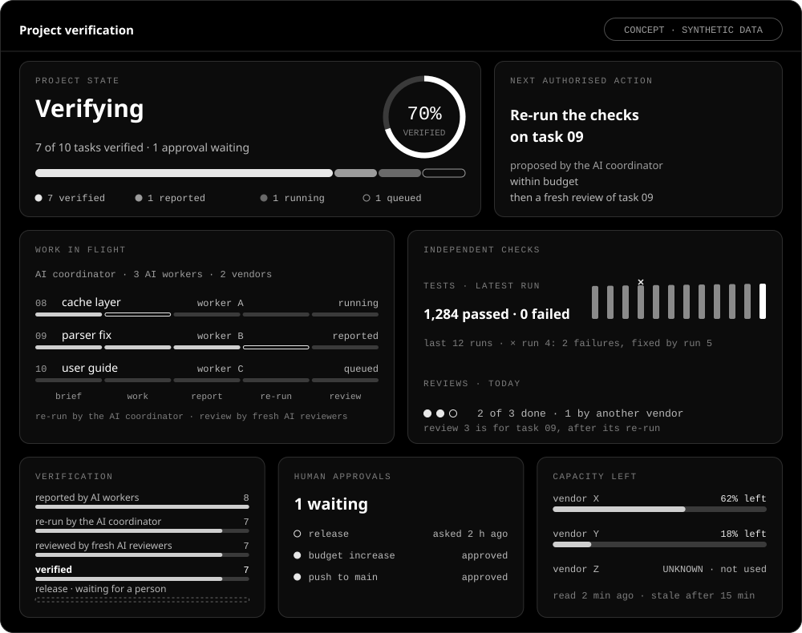

# AI Engineering Harness

**An engineering system for building software with AI coding agents from several vendors, in which no agent's
report is taken on trust and a person keeps the final say.**



*Dashboard concept · Illustrative design with synthetic data, not a screenshot.*

In plain terms: AI coding agents are programs, driven by AI models, that read and write code. Here, one AI
agent, the *coordinator*, divides a software task and gives each part, with clear limits, to other AI agents,
the *workers*. The workers write code and report what they did. The coordinator re-runs the checks itself,
independent AI reviewers then look for mistakes, and the results and decisions are written down. A person sets
the limits and approves the steps that matter. The *Runtime Pack*, this repository, is the versioned core of the
harness: the written procedures the coordinator follows, its rules and templates, and the tools that check the
work.

**Why it matters.** Coding agents work quickly, but their reports about their own work can be wrong: a test an
agent wrote may pass even when the code is broken. Models from different vendors have different strengths, and
one can check another's work, but only if all of them work to a shared process with independent checks. Long
runs also need a way to show what is finished, stuck or waiting for a person. Calling several models is easy;
knowing which of their results to trust is the hard part.

**What makes it different.** Trust is earned for one exact configuration (the coding tool, model, settings and
kind of task), never assumed from a model's name. The coordinator follows the pack's written procedures, and
every result must pass the pack's checks, whichever vendor's model produced it. Because the rules live in one
versioned pack, every project can use the same ones and prove exactly which version it runs. If something the
rules need cannot be confirmed, the work stops there: the answer is no. Releases, budgets and publication are
recorded human decisions, because those choices carry risks that should not rest on an AI's report.

**Who made it.** Designed and directed by one engineer, who set its architecture and governance rules and made the
release decisions; implemented by AI coding agents (a coordinator model and the workers it dispatches) working under
the system's own rules.

**How one task flows through it**

1. A person sets the goal, the scope and the budget.
2. The coordinator divides the work and gives each worker a brief: written instructions saying what it may
   change and which checks must pass.
3. Each worker returns its code changes and a report.
4. The coordinator re-runs the checks itself; a test that could never fail does not count.
5. Independent reviewers, other AI agents starting fresh, try to find faults. Significant changes (the pack
   calls them material) get two reviewers, one from a different vendor where available.
6. The result is recorded. Nothing is pushed (sent to a shared copy) or released without a person's decision.


*The six roles and how one task passes between them; the numbers follow the six steps above. The Runtime Pack
(this repository) is the set of rules and checks that govern the AI roles; it starts nothing by itself.*

- **Stable: 2.5.0** — `QUALIFIED_AND_FROZEN` since 2026-09-10 (it passed its release checks and was frozen by a
  recorded human decision; a fix would be a new release), on branch `stable/2.5.0`.
- **Development: 2.6.0** — `IN_PROGRESS` on the default branch `main`: unfinished; not qualified, not frozen,
  not for projects to adopt.

**Requirements:** macOS first (on other systems, governed Git reads, explained in section 6, are refused) · Python
3.12 or newer (the tools need no extra packages; the tests need pytest) · Git.

## Contents

The opening is written for every reader; sections 1–3 explain the idea and the roles; sections 4–10 show how it
works and how to try it; sections 11–14 cover status, limits, layout and licence.

1. [What this is, and what it is not](#1-what-this-is-and-what-it-is-not)
2. [Why it exists](#2-why-it-exists)
3. [Roles and boundaries](#3-roles-and-boundaries)
4. [A unit of work, end to end](#4-a-unit-of-work-end-to-end)
5. [Working with several AI vendors](#5-working-with-several-ai-vendors)
6. [Safety and fail-closed behaviour](#6-safety-and-fail-closed-behaviour)
7. [Releases, pinning and multiple projects](#7-releases-pinning-and-multiple-projects)
8. [Quick start](#8-quick-start)
9. [A one-minute example](#9-a-one-minute-example)
10. [Evidence: tests and independent review](#10-evidence-tests-and-independent-review)
11. [Status and roadmap](#11-status-and-roadmap)
12. [Limitations](#12-limitations)
13. [Repository layout](#13-repository-layout)
14. [Licence](#14-licence)

**Key terms, in plain words**

- **AI coding agent:** a program driven by a language model that can read and write code when asked.
- **Model:** the AI system that does the reasoning; one vendor may offer several.
- **Coordinator and workers:** the coordinator plans, assigns and checks work. Each worker does one limited task.
- **Runtime Pack:** this repository's versioned procedures, rules, templates and checking tools. It starts no work
  by itself.
- **Vendor:** the company behind an AI model, such as Anthropic, OpenAI or Z.ai.
- **Configuration:** the exact coding tool, model, settings and task type used together.
- **Repository:** a project's files together with their Git history.
- **Git, commit and branch:** Git keeps file history. A commit records a change; a branch names a line of changes.
- **Push:** sending commits to another copy of a repository, such as one on GitHub.
- **Release, frozen and pin:** a release is a numbered pack version. A frozen version does not change. A project
  pins the exact version it uses so it can check its identity.
- **Material change:** a significant change; it needs a frozen design and two independent reviewers.
- **Adapter:** a small program that lets the coordinator drive another vendor's coding tool.
- **Governed Git read:** a read of a repository made under the pack's rules, inside the macOS sandbox, so that Git
  cannot start any program.
- **Gate:** checks that must pass before work counts, a release is frozen or anything is published.
- **Fail-closed:** if a required fact cannot be established, the answer is no.
- **Test suite:** automatic checks of what the software does.

## 1. What this is, and what it is not

AI Engineering Harness is a local engineering system for software work with several AI coding agents. It is not a
collection of prompts or scripts: it is a governed way of working, with its own rules, tools and records. A person
directs the work; an AI coordinator gives bounded tasks to workers and checks their results. Independent reviewers
look for faults. Files and Git keep the decisions and evidence.

The Runtime Pack is the reusable core. It contains written procedures for the coordinator, policy, project
file templates and small Python tools that keep no project state between runs. It gives different projects the
same rules without taking authority away from their owners. Its design brings five things into one workflow: work
routed by recorded results, independent review, written evidence, fixed budgets and human decisions.

The dashboard at the top of this page is a design concept, not a screenshot. Today, the harness shows a project's
state as a read-only web page, rebuilt from the project's files by `tools/projection.py --html`;
`tools/console.py` shows several projects at once.

Its main boundaries are:

- Workers cannot make their own reports authoritative. The coordinator checks them again.
- Qualification belongs to a configuration, not a model brand or family. A configuration that has never been run
  qualifies for nothing.
- Unknown or unsafe inputs cause a named refusal, rather than a guessed answer.
- A project pins an exact frozen release. A fix to that release requires a new one.
- A person decides at named checkpoints, including budgets, exceptions, pushes, releases and publication.

## 2. Why it exists

Coding agents can produce useful changes, but the surrounding process determines whether those changes can be
trusted. Six recurring problems shaped this system:

- Agents can report passing checks that did not run or could never fail.
- A model's ability changes with its coding tool, settings, task and restricted running environment.
- A long task can stall, run out of capacity or finish without anyone noticing.
- Even reading a repository with Git can start programs named in that repository's own Git settings, on the
  reader's machine.
- Private information can appear in messages, file paths, notes or history before a push.
- Written rules can drift away from what the tools actually enforce.

The pack turns these risks into checks and recorded steps. The person keeps decisions that require judgement.

The design followed a measured failure. Its predecessor kept project state and authority in a software
"kernel": the part that remembered the project between runs. That stateful part failed four audit rounds,
while its small stateless checkers, which keep nothing between runs, survived each one
(`CHANGELOG.md`, 2.0.0-wave-a; `DECISIONS.md` D1). The pack kept the checkers. Written procedures, project
records and human decisions now carry authority.

## 3. Roles and boundaries

Six roles divide the work. The diagram above shows what passes between them.

- **Human:** sets the goals and decides at the named points of a 17-row decision matrix
  (`policy/hitl-matrix.md`). If a decision-maker who is needed is unavailable, the work waits: unavailability
  never counts as permission.
- **AI coordinator:** plans, assigns, checks and combines the work. It alone writes to governed branches, the
  branches that hold the project's accepted history. It keeps no lasting project state inside software: what
  must survive is written to files.
- **Runtime Pack:** supplies procedures, policy, templates and stateless checks. It does not launch agents, hold
  project state or decide for the person.
- **AI workers:** use a bounded brief to produce changes and reports. They cannot commit to governed branches or
  grant themselves authority; external adapters (small programs that drive another vendor's coding tool) are
  installed and pinned separately.
- **Independent reviewers:** start with fresh context and try to find faults. They do not change the work they
  review, and they read neither its design documents nor the reports on its repairs.
- **Project record:** stores scope, progress, findings, decisions and evidence in files and Git. It is the single
  authoritative account; nothing duplicates it elsewhere.

The pack's procedures (its skills) name roles, not vendors. Vendor names appear mainly in its policy and evidence
log, some templates, a few tools, the tests and the historical records. In this project's own use, the
coordinator runs as Claude Opus in Claude Code; workers have included Claude Code subagents and the OpenAI Codex
CLI and, on the 2.6.0 line, Z.ai's GLM models through an Anthropic-compatible adapter.

The coordinator dispatches workers. The pack has no background dispatcher or service that starts them.

## 4. A unit of work, end to end

These steps are `SHIPPED` in 2.5.0. The 2.6.0 line refines routing and billing checks; it does not change the
basic flow.

1. **Pin and open.** A project contract (`PROJECT.yaml`) records the exact release. `tools/pack_pin.py` checks it.
   `tools/capability_open.py` combines pin, adapter, project context and design readiness for one block of work.
   An adapter is checked by a digest, a fingerprint of its files (`tools/adapter_pin.py`).
2. **Design before code.** For a material change, a frozen design names alternatives, failure modes, authority
   boundaries and expected checks. Independent readers try to find faults before coding. The design gate rejects
   a design frozen against a file tree that already contains its implementation (`tools/design_record.py`, D25).
3. **Brief and dispatch.** A worker gets a frozen brief with a write ceiling: the files it may change. Work that
   changes files runs in a restricted environment; only read-only work may run without one (`tools/confine.py`).
   Dispatch also checks known capacity and the configuration's own qualification (`tools/capacity.py`,
   `tools/qualification.py`, `tools/routing.py`).
4. **Wait without losing track.** Deadlines are declared before launch. The pack derives waiting state from files,
   so a job that has finished is recorded as finished even if nobody was watching (`tools/continuation.py`). It
   checks several signs of life and classifies bounded output before a retry (`tools/progress.py`,
   `tools/task_output.py`).
5. **Verify.** The coordinator reruns checks. For a targeted test, the pack confirms the intended tests were
   selected; a zero exit code alone cannot show that (`tools/selector_evidence.py`). Evidence is indexed by its
   contents and kept with owner-only access (`tools/evidence_put.py`, `tools/evidence_index.py`).
6. **Audit and repair.** Routine work gets one fresh, blind reviewer. A sample picked by a fixed formula, which
   the coordinator cannot steer, also gets a cross-vendor review. Material work gets two reviewers, one
   cross-vendor where available; a substitute requires a recorded human decision (`skills/core/audit-strategy.md`,
   `policy/auditor-strategy.md`). Repair must reproduce the
   fault, find its cause and show that a check detects it before fixing it (`skills/core/repair.md`). Repair
   budgets stop work with an open material finding when exhausted (`policy/BUDGETS.md`).
7. **Close.** `tools/close_attestation.py` lists every declared validation profile, including any that did not
   run, marked `UNRUN`. An omitted check cannot disappear from the closure record.
8. **Publish through gates.** History scans inspect each reachable occurrence (`tools/publication_history.py`,
   `tools/outgoing_scan.py`). Commit messages follow a structure and private-vocabulary contract
   (`tools/commit_gate.py`). The publication gate checks the allowed source, reachability, exact push mapping
   and receiving copy after a push (`tools/publication_gate.py`).
9. **Release.** Version changes are derived from the code surface and from answers compared with the previous
   frozen release (`tools/surface_diff.py`, D28). A human records the freeze decision. Projects move to a new
   version at a named work boundary with a rollback path (`tools/pack_migration.py`).

## 5. Working with several AI vendors

All vendors' workers follow the same brief, evidence and review rules. A qualification says that one exact
configuration has worked for a type of task; it does not endorse a whole model family.

- **Identity has nine parts:** surface, family, client, observed model, effort, isolation, network,
  authentication class and task class. If any part is missing, the record qualifies nothing
  (`tools/qualification.py`).
- **Ability and availability are separate.** Evidence that a configuration can do a task does not show that it
  can start now (`tools/routing.py`).
- **The log is authoritative.** Dispatch observations go into append-only `policy/observations.jsonl` (62 rows at
  the 2.6.0 checkpoint). The routing table is rebuilt from those rows. Tests compare its figures with the log.
  Adverse observations remain visible.
- **Independence is judged by model vendor on the 2.6.0 line.** A different gateway does not make the same
  vendor's model independent (D30). The line also rehearsed registering a third model family, reported
  unauthorised and then authorised, with no vendor name reaching the routing or provider-manifest tools.

## 6. Safety and fail-closed behaviour

If a required fact cannot be established safely, a gate refuses the operation and explains why.

- **Governed Git reads block repository-controlled programs.** The tool constructs a fresh Git directory with
  blank configuration. It denies child programs with macOS Seatbelt, the built-in macOS sandbox, and checks Git's
  own Trace2 record for any attempt to start one. Without that barrier, the read is refused.
- **Publication checks the complete route.** A clean working tree is insufficient. The gate checks an allowed
  source ref (a named pointer into history), reachability, an exact push mapping and the receiving copy
  afterwards (`tools/publication_gate.py`, D7).
- **Private vocabulary is checked in context.** Credentials, machine paths, identifiers, prompts, session state
  and quota history must stay out of version control. A tiered vocabulary distinguishes commit-message terms
  from terms that are noise in content (`skills/core/public-safety.md`, D9, D16).
- **Billing must be proven on the 2.6.0 line.** A route is refused unless its billing is shown to be an
  authorised subscription or local pool, regardless of credentials in the environment (D29, D32).
- **Autonomy has limits.** Repair and audit counters can stop work. A 17-row matrix names the decisions a person
  makes, including pushes, credentials, destructive actions, scope, budgets and exceptions
  (`policy/hitl-matrix.md`).

## 7. Releases, pinning and multiple projects

A frozen release never changes. Each project records which one it uses and checks that identity.

- **One version and manifest.** `VERSION` names the version. `PACK_MANIFEST.json` records its state, file-tree
  fingerprint, qualified test population and gate record. A human freezes a named candidate after its gate.
- **A four-field pin.** A project records the pack's root path, version, full 40-character revision and tree
  digest. It checks all four and the `QUALIFIED_AND_FROZEN` state with that release's own `tools/pack_pin.py`
  (D11, D13, D18).
- **Several projects can use different releases.** Each has its own operational records. No project run changes
  its pinned pack.
- **Adoption is deliberate.** A newer release is information, not an obligation: a project moves to it
  deliberately, at a capability boundary, with a rollback path (`tools/pack_migration.py`, D21).
- **Declarations have one source.** The project contract supplies the gates' shared facts
  (`tools/project_contract.py`). Project context is checked for identity, never judged for content
  (`tools/project_context.py`).

## 8. Quick start

Clone the repository with GitHub's **Code** button. From your local checkout, run:

```text
cd ai-engineering-harness
git switch stable/2.5.0     # the latest QUALIFIED_AND_FROZEN release; main is development

# macOS: governed Git reads forbid child processes, and Apple's /usr/bin/git is a shim
# that may need to start one (xcodebuild) to find the real binary. Put the real git
# first on PATH, for this shell only:
export PATH="$(xcode-select -p)/usr/libexec/git-core:$PATH"

python3 tools/pack_pin.py . --version "$(cat VERSION)" --sha "$(git rev-parse HEAD)" \
    --digest "$(python3 -c 'import json;print(json.load(open("PACK_MANIFEST.json"))["tree_digest_sha256"])')" \
    --state "$(python3 -c 'import json;print(json.load(open("PACK_MANIFEST.json"))["state"])')"
# -> pack pin verified: .

# .venv/ is ignored, and exempt from the pin check:
python3 -m venv .venv && . .venv/bin/activate
python3 -m pip install pytest
python3 -m pytest tools/tests/test_commit_gate.py -q   # 88 tests, under a minute
python3 -m pytest tools/tests/ -q                      # the full suite: under 30 minutes
```

On macOS, `xcode-select -p` locates the active developer tools, and the PATH step selects their real `git` for
this shell only. Governed reads hide the directory that contains the checkout from Git, so a `git` kept there
(for example `~/bin/git` for a checkout directly under `~`) cannot be used. On Linux and other systems, governed
Git reads are refused by design, so the pin check and the tests that use them do not pass there; the other Python
tools are portable.

## 9. A one-minute example

Check a commit message against the pack's structure and default private vocabulary:

```text
cat > /tmp/msg.txt <<'EOF'
fix(gitread): refuse helper programs named by repository configuration

- Refuse configuration keys that name a program to run.
- Pin the refusal with a regression test.
EOF
python3 tools/commit_gate.py --default-terms . /tmp/msg.txt
# vocabulary: 35 term(s), 15 identity-only term(s), 7 pattern(s), 1 identity-only pattern(s); read from …
# VALID
```

The command prints the vocabulary file's identity, then `VALID` or a reason for refusal. It rejects private
terms, extra structured trailers (the 'Key: value' lines at the end of a message) and hidden characters.

Derive qualification and routing from the evidence log:

```text
python3 tools/qualification.py policy/observations.jsonl
python3 tools/routing.py policy/observations.jsonl
```

`qualification.py` separates each exact configuration's record from the advisory history of its model family.
`routing.py` reports which configurations qualify. Availability stays `UNKNOWN` because these commands read
records; they do not dispatch work.

The [Quick start](#8-quick-start) pin check uses values from the checkout itself. It checks internal
consistency. A consuming project verifies its recorded version, revision, digest and state against the release
it pinned ([section 7](#7-releases-pinning-and-multiple-projects)).

## 10. Evidence: tests and independent review

The pack has tests of normal behaviour, tests designed to break its guards and independent AI review.

- **The suite.** On `stable/2.5.0`, 3,011 pytest tests pass. On `main` (2.6.0), 3,317 of 3,319 tests pass; the other
  2 are skipped by the line's own conditions, because they check records the line has not produced yet. Measured on
  macOS with Python 3.14.0 and Git 2.50.1. Passing tests do not qualify a development line.
- **Tests of the tests.** A meta-test checks for assertions that cannot fail
  (`tools/tests/test_no_oracle_is_vacuous.py`). Mutation tests break guards on purpose to see whether the tests
  catch the change (`docs/acceptance/rp2.5.0-mutation.py`).
- **Differential acceptance.** Deliberately hostile repositories and comparisons with the previous frozen
  release exercise governed Git reads (`docs/acceptance/`).
- **Records are checked.** Tests recompute figures in the changelog, manifest and gate records
  (`tools/tests/test_release_integrity.py`).
- **Blind independent audits.** Since 2.3.0, material designs face independent review before implementation
  (D25). Releases close with blind audits, one cross-vendor where available, followed by bounded repair.

**Notes on running the tests**

- The suite needs a Git identity because some tests commit using the machine's own identity. Set `user.name`
  and `user.email`, for example with `git config --global`. Do not export `GIT_AUTHOR_*` or
  `GIT_COMMITTER_*` variables in the test shell.
- Two wait tests are timing-sensitive. They create the file before declaring the wait, and the declaration has
  only whole-second precision. Crossing a second boundary can make the file look too old and cause a correct
  refusal. Details: [test timing notes](PUBLIC_EDITION.md#known-timing-sensitive-tests).
- Some fixtures contain hidden Unicode characters on purpose to test the commit gate. GitHub may flag them.

## 11. Status and roadmap

Status words: **`QUALIFIED_AND_FROZEN`** means a gate qualified the release and a human recorded its freeze; it
never changes and a project may pin it. **`SHIPPED`** means part of a qualified release. **`IN_PROGRESS`** means
development, not qualified and not to be pinned. **`PLANNED`** means a recorded candidate with a trigger, not a
commitment.

| Version | Date and theme | Status |
|---|---|---|
| 2.0.0 | 2026-08-13 · hybrid architecture | superseded |
| 2.1.0 | 2026-08-15 · first project's evidence | superseded |
| 2.1.1 | 2026-08-15 · release integrity | QUALIFIED_AND_FROZEN |
| 2.2.0 | 2026-08-21 · adapter and tool integrity, execution truth | QUALIFIED_AND_FROZEN |
| 2.3.0 | 2026-09-05 · durable execution, liveness, capacity, history safety | QUALIFIED_AND_FROZEN |
| 2.4.0 | 2026-09-05 · qualification by configuration | QUALIFIED_AND_FROZEN |
| 2.4.1 | — · Git read repairs; convergence blocker | never released (IN_PROGRESS) |
| **2.5.0** | 2026-09-10 · constructed Git read boundary | QUALIFIED_AND_FROZEN — latest stable |
| 2.6.0 | 2026-09-19 → 2026-09-20 · providers, billing, capacity freshness | IN_PROGRESS — development on `main`, not a release |

See [release notes](RELEASE_NOTES.md) for each version and `CHANGELOG.md` for the full record. The recorded work
spans 270 historical commits and five qualified releases through 2.5.0.

**2.5.0** is the version to run and evaluate. Its governed Git reads use a constructed directory and deny child
programs. Its gate record includes a differential against 2.4.0 (the same reads run on both releases and their
answers compared) over 49 fixture repositories and 200 read forms. It also includes a hostile-repository matrix,
mutation tests and two independent certifications that ended ready.

**2.6.0** remains `IN_PROGRESS`: not qualified, not frozen and not adoptable. Its gate record is
`docs/RP2.6.0-GATE.md` on `main`.

**On the development line already (with tests)**

- Providers are declared as validated manifests, with a billing-route check (`tools/provider_manifest.py`).
- Review independence is judged by model vendor, and routing can report eligible configurations
  (`tools/routing.py --eligibility`).
- Provider quota readings, whether taken by a tool or entered by a person, record when they were taken, so their
  freshness can be checked
  (`tools/resource_observation.py`). Capacity pools use that freshness, and one validated writer updates the
  capacity record (`tools/capacity.py`, `tools/capacity_record.py`).
- A read-only-mode test covers each touched tool. A rehearsal registered a third model family without any vendor
  name reaching the routing or provider-manifest tools.

**Not done yet**

- Quarantine for evidence rows and waits; bounded gate waits with a truthful `PAUSED` state; the rendering-only
  overview.
- The cost-policy check before capacity arithmetic, which is only partly in place.
- An adapter function-probe basis and the sterile scratch repair.
- Closure audits, cross-vendor certification and a recorded human freeze decision.

`PLANNED` evolution candidates in `PACK_MANIFEST.json` include a durable event log, a multi-year activity
calendar, measured yield from same-family and cross-vendor audits, an execution-trace check shipped as a tool,
and read-only enumeration of a bundle's objects. Each has a trigger. The manifest also records deferred work.

## 12. Limitations

- **macOS-first:** governed Git reads need the macOS sandbox and are refused on other hosts. The remaining
  toolbelt is portable Python.
- **Local and single-user:** this is not a hosted service, multi-user platform or worker dispatcher.
- **Separate adapters:** worker adapters are installed outside the pack and pinned by digest.
- **Development line:** 2.6.0 is unfinished; [section 11](#11-status-and-roadmap) lists the gaps.
- **Test notes:** Git identity, timing-sensitive tests and hidden Unicode fixtures are covered in
  [section 10](#10-evidence-tests-and-independent-review).

## 13. Repository layout

```text
ai-engineering-harness/
├── README.md          # pack guide
├── VERSION            # version
├── PACK_MANIFEST.json # identity
├── CHANGELOG.md       # changes
├── DECISIONS.md       # decisions
├── skills/core/       # procedures
├── policy/            # rules, logs
├── templates/         # for projects
├── tools/             # Python tools
│   └── tests/         # tests
├── docs/              # gate records
└── .github/           # page, assets
```

**In numbers**

| Measure | 2.5.0 / 2.6.0 line |
|---|---|
| Tool modules | 40 / 42 |
| Lines of tool code | 29,780 / 33,372 |
| Test modules | 52 / 55 |
| Lines of tests | 33,282 / 37,151 |
| Files in `templates/` | 24 / 27 |
| Recorded decisions | 28 / 36 |

`policy/` holds routing evidence, budgets, approvals and private-term defaults. `templates/` holds files that
projects copy and fill in. `docs/` holds gate records, designs and acceptance checks. `.github/` holds this page and
its images, the release notes and [notes on this repository's history](PUBLIC_EDITION.md). Decisions are numbered
D1–D28 in 2.5.0 and D1–D36 on the 2.6.0 line.

## 14. Licence

No licence has been granted yet. Until one is added, all rights are reserved by the author: you are welcome to
read the code here, but copying, modifying or redistributing it requires permission.

This is a personal engineering project and is not currently set up for outside contributions; issues and
questions are welcome.
