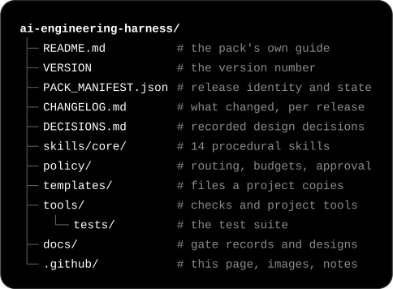

# AI Engineering Harness

**An engineering system for building software with AI coding agents from several vendors, in which no agent's
report is taken on trust and a person keeps the final say.**

In plain terms: one AI *coordinator* breaks a software task into pieces and hands them to other AI coding agents,
the *workers*. It accepts nothing they report until the checks have been re-run, independent reviewers have tried
to prove the work wrong, and the result has been recorded.

**Why it matters.** Coding agents are fast but unreliable witnesses of their own work. A test an agent wrote can be
unable to fail, the same model can behave differently in another coding tool, and a long run can stop without anyone
noticing. Calling several models is easy; knowing which of their results to trust is the hard part.

**What is different.** Trust is earned, never assumed. A model is trusted only in the exact setup in which it has
been shown to work; whatever cannot be established is treated as a "no"; and every release, budget and publication
is a person's recorded decision.

**Who made it.** Designed and directed by one engineer, who set its architecture and governance rules and made the
release decisions; implemented by AI coding agents (a coordinator model and the workers it dispatches) working under
the system's own rules.

**How one task flows through it**

1. A person sets the goal and its limits: the scope and the budget.
2. The coordinator splits the goal into tasks and gives each worker a brief: what it may change, and which checks
   must pass.
3. A worker agent, possibly from another vendor, does the work and reports back. The report is a claim, not proof.
4. The coordinator re-runs the checks itself; a test that could never fail does not count.
5. Independent reviewers, starting fresh, try to prove the work wrong. A significant change (the pack calls it
   material) gets two, one of them from a different vendor where one is available.
6. Only then is the work recorded as done. Nothing is pushed or released without a person's decision.

![Diagram of the six roles. At the top, the human sets goals, limits and budgets and decides at named checkpoints; decisions go down to the AI coordinator and evidence comes back up. The AI coordinator, the AI workers and the reviewers work inside the Runtime Pack, the versioned rules and checks that govern them: the coordinator follows its procedures, and the workers and reviewers work from the scoped briefs the coordinator gives them. The coordinator sends briefs to the AI workers, which return reports, and sends claims to the independent reviewers, who return findings. At the bottom, the coordinator reads and writes the project record: decisions, evidence, findings and progress, in files and Git.](assets/architecture.svg)

*The six roles and what passes between them. The Runtime Pack (this repository) is the set of rules and checks that
govern the AI roles; it starts nothing by itself.*

- **Stable: 2.5.0** — `QUALIFIED_AND_FROZEN` on 2026-09-10, on branch `stable/2.5.0`.
- **Development: 2.6.0** — `IN_PROGRESS` on the default branch `main`: not qualified, not frozen, not adoptable.

Only a `QUALIFIED_AND_FROZEN` release, one that passed its release gate and was then frozen by a recorded human
decision, is meant for projects to use. All status words are defined in
[section 11](#11-status-stable-250-and-development-260).

**Requirements:** Python 3.12 or newer (standard library only) · Git · macOS-first.

The recorded history runs from 2026-08-13 to 2026-09-20: 270 historical commits, five qualified releases up to
**2.5.0**, and a **2.6.0** development line opened on 2026-09-19 and paused at a checkpoint on 2026-09-20. This
repository is a reviewed public edition of that history ([section 15](#15-about-this-public-edition)).

## Contents

The opening above needs no technical background; sections 1–3 explain the design with some technical terms;
sections 4–10 are written for engineers; sections 11–16 cover status, limits and this edition.

1. [What this is, and what it is not](#1-what-this-is-and-what-it-is-not)
2. [Why it exists](#2-why-it-exists)
3. [Roles and boundaries](#3-roles-and-boundaries)
4. [A unit of work, end to end](#4-a-unit-of-work-end-to-end)
5. [Multi-provider orchestration and routing](#5-multi-provider-orchestration-and-routing)
6. [Safety and fail-closed behaviour](#6-safety-and-fail-closed-behaviour)
7. [Releases, pinning and multiple projects](#7-releases-pinning-and-multiple-projects)
8. [Quick start](#8-quick-start)
9. [A one-minute example](#9-a-one-minute-example)
10. [Evidence: tests and independent review](#10-evidence-tests-and-independent-review)
11. [Status: stable 2.5.0 and development 2.6.0](#11-status-stable-250-and-development-260)
12. [Roadmap](#12-roadmap)
13. [Limitations and design boundaries](#13-limitations-and-design-boundaries)
14. [Repository layout](#14-repository-layout)
15. [About this public edition](#15-about-this-public-edition)
16. [Licence](#16-licence)

## 1. What this is, and what it is not

This is not a collection of prompts or scripts. It is a custom engineering system that coordinates several AI
coding agents, distributes work according to their measured capabilities, enforces safety and verification
boundaries, preserves evidence, and supports reliable software development across projects. Its core, the **Runtime
Pack** (this repository), is the part that is versioned and released: procedural skills (written procedures the
coordinator follows), policy, templates and a toolbelt of stateless Python checkers that keep nothing between runs (40
modules in 2.5.0, 42 on the 2.6.0 line). Its value lies less in any single checker than in two structures: the
**architecture of collaboration** between a human, a coordinator, workers and independent reviewers, and the
**engineering governance of AI-assisted development** — release identity, evidence, budgets and named human
decisions.

Five properties carry most of the weight:

- **A worker's report is a claim until re-run.** "All tests pass" from an agent is testimony, not evidence. The
  coordinator re-runs what a worker reported before accepting anything, and a test that cannot fail is not
  treated as a test.
- **Qualification belongs to a configuration, not a model family.** What has been shown to work is an exact
  combination — the coding tool, the model, its settings and the kind of task — never a vendor's name, and never a
  model family's track record borrowed by a model that has not run.
- **Fail-closed safety: unknown means no.** An unprobed configuration qualifies nothing; a reader that cannot
  trust a record refuses it rather than guessing; a repository that cannot be read safely is not read.
- **Immutable releases, pinned by four fields.** Root path, version, full revision and tree digest. A frozen
  release never changes; a fix is a new release.
- **Human authority at named decision points.** Every push, credential change, budget, waiver, release and
  publication is a recorded human decision, at a named row of a 17-row matrix — never something the system
  takes on itself, and coordinator unavailability never implies authorisation.

## 2. Why it exists

AI coding agents are fast, but most of what makes their output trustworthy happens around them. Six problems
motivated this system:

- **Self-reports are not evidence.** An agent's "all tests pass" can be wrong, and a test it wrote can be unable
  to fail.
- **Vendors and configurations differ.** A model that is good at extraction may be poor at review; the same model
  behaves differently under another client, effort level or sandbox. Availability is not qualification.
- **Long autonomous runs fail quietly** — a hung process, an exhausted usage window, a finished job nobody
  noticed.
- **Repositories can execute code when read.** Git hooks, filters, text-conversion drivers, `fsmonitor`,
  external diff helpers and transports are all ways a repository under inspection can run a program on the
  inspector's machine.
- **Private context leaks** into commit messages, paths, notes refs and history long before anyone pushes.
- **The governing documents drift** from what the code actually does, and nobody notices because nobody checks.

Runtime Pack turns each of these into something a tool can check, and leaves to a human only the decisions where
judgement is irreducible.

The design itself came from a measured failure. The predecessor of this pack was a deterministic "kernel" whose
software held project state and authority; across four audit rounds that stateful authority failed every round,
while its small stateless checkers survived every one (`CHANGELOG.md`, 2.0.0-wave-a; `DECISIONS.md` D1). Runtime
Pack keeps only the checkers and moves authority to procedure, durable records and human decisions.

## 3. Roles and boundaries

Six roles divide the work. The diagram at the top of this page shows what passes between them; the table says what
each one does and what it never does.

| Role | What it is | What it does | What it never does |
|---|---|---|---|
| **Human** (release authority) | the person who owns the work | decides releases, pushes and publication, credentials, budgets, waivers and limitations — at named rows of a 17-row matrix (`policy/hitl-matrix.md`) | is never simulated: coordinator unavailability never implies authorisation |
| **AI coordinator** | one AI session (a frontier model) | decomposes the work, routes it by measured capability, diagnoses failures, synthesises results — and is the only one that writes to governed branches, the branches that hold the project's accepted history | holds no durable state in software: everything that must survive is written to files |
| **Runtime Pack** (the Core) | this repository: skills, policy, templates, toolbelt | carries the procedure to follow, the policy and budgets to enforce, and the stateless checkers that report and refuse | holds or adjudicates state, names a vendor in its skills, or launches anything |
| **AI workers** (execution surfaces) | the native harness's subagents, and external adapters that drive other vendors' coding CLIs | execute a frozen brief, confined whenever they can write (a generated sandbox profile or the runtime's own), and return a patch and a report | commit to a governed branch, or act as authority: adapters are installed outside the pack and pinned by digest |
| **Independent reviewers** | auditors with fresh context, blind to each other | try to falsify the work; for material changes, two of them, one cross-vendor where available — a substitute is a recorded human decision | edit the thing they review, or read its design documents and repair reports |
| **Project record** | files and Git (`PROJECT.yaml`, scope, progress, findings, decisions, handoff) | the authoritative account of what was asked, done, found and decided — never duplicated elsewhere | — |

The Core's skills name no vendor: they describe roles, not products. Vendor names do appear elsewhere in the
repository: in the policy and its evidence log, some templates, a few tool modules, the tests and the historical
records. In this project's own use, the coordinator is a Claude Opus session running in Claude Code; workers have
included Claude Code subagents, the OpenAI Codex CLI and, on the 2.6.0 line, Z.ai's GLM models reached through an
Anthropic-compatible adapter.

Nothing in the pack launches a worker by itself: no dispatcher, no daemon. The coordinator dispatches; the pack
checks what was dispatched, what came back, and whether a claim survives re-execution.

## 4. A unit of work, end to end

The lifecycle of one unit of delegated work, with the module that enforces each step. Every step is `SHIPPED` in
2.5.0; the 2.6.0 line refines routing (vendor-based independence, billing safety) without changing the shape.

1. **Pin and open.** Work starts from a project contract (`PROJECT.yaml`, instantiated from
   `templates/PROJECT.yaml.template`) that pins an exact release and is verified by the release's own
   `tools/pack_pin.py`. `tools/capability_open.py` composes pin, adapters, context and design record into one
   readiness answer before a capability opens. Adapters are verified by digest (`tools/adapter_pin.py`).
2. **Design before code.** A material change begins with a frozen design record — alternatives, one rejected
   with a reason, failure modes, authority boundaries, oracles — that independent readers try to falsify before
   implementation (`tools/design_record.py`; decision D25 in `DECISIONS.md`). The revision binding refuses a
   design frozen against a tree that already contains the work it governs.
3. **Brief and dispatch.** The worker receives a frozen brief with an explicit write ceiling
   (`templates/task-brief.template.md`) — the entire envelope it sees. A dispatch that can write runs confined, by a
   generated sandbox profile or the runtime's own, and only read-only work may run unconfined (`tools/confine.py`);
   the dispatch is refused before it is issued when the capacity it needs is not known to be there
   (`tools/capacity.py`). Which configuration may take the work is answered by the
   configuration's own qualification (`tools/qualification.py`) and by `tools/routing.py`.
4. **Wait durably.** Waits are declared with deadlines before launch; waiting state is derived from artifacts on
   disk rather than stored, so a job that exits advances the record whether or not anyone notices
   (`tools/continuation.py`). Liveness is a disjunction of signals, telling a quiet worker from a dead one
   (`tools/progress.py`); task output is written in bounded pieces and classified before any retry
   (`tools/task_output.py`).
5. **Verify.** The coordinator re-runs the evidence. A targeted test run must prove it selected the tests it
   claims (`tools/selector_evidence.py` — exit status 0 is not evidence that the intended check ran). Evidence
   is kept content-addressed, owner-only and indexed (`tools/evidence_put.py`, `tools/evidence_index.py`).
6. **Independent audit and bounded repair.** Closure audits are fresh-context and blind, and the auditors do not
   read the design documents or repair reports. Routine work gets one auditor, plus a cross-vendor review on a
   seeded sample of changes that the coordinator cannot steer; a material change gets two auditors, one
   cross-vendor where available, and a substitute only by a recorded human decision
   (`skills/core/audit-strategy.md`, `policy/auditor-strategy.md`). Repair follows a fixed discipline: reproduce,
   isolate the root cause, state the invariant, write a discriminating oracle, mutation-check it, then fix
   (`skills/core/repair.md`) — inside frozen budget counters, where exhausting a budget with an open material finding
   is a stop (`policy/BUDGETS.md`).
7. **Close.** The closure block is generated from the validation profiles the contract declares, so a declared
   profile that never ran is enumerated and reported `UNRUN`: omission is unrepresentable
   (`tools/close_attestation.py`).
8. **Publish only through the gates.** The complete reachable history is scanned at a strict tier with
   per-occurrence adjudication (`tools/publication_history.py`, `tools/outgoing_scan.py`); commit messages meet
   a structural and vocabulary contract (`tools/commit_gate.py`); and publishing itself is a ref-namespace
   contract — allowed source ref, reachability, one exact push refspec, and a remote postcondition verified
   afterwards (`tools/publication_gate.py`).
9. **Release.** The version bump is derived, not asserted: from the public API surface and from the answer
   contract — a frozen-floor differential that checks callers are still told the same thing
   (`tools/surface_diff.py`, D28). A recorded human decision freezes the release. Projects adopt a newer
   release only at capability boundaries, deliberately, with a rollback path (`tools/pack_migration.py`).

## 5. Multi-provider orchestration and routing

In short: every vendor's agent works under the same rules, and trust attaches to an exact, measured configuration
rather than to a brand.

- **Briefs in, claims out.** A worker receives a frozen brief with a write ceiling and returns a patch and a
  report; the coordinator re-runs the evidence before anything is accepted, and workers never commit to a governed
  branch. The same rules apply to every vendor.
- **Nine dimensions identify a configuration.** Surface, family, client, observed model, effort, isolation,
  network, authentication class and task class. A configuration nothing has run is `unprobed`; an identity with
  an unobserved dimension qualifies nothing; family history is display-only and ranks nothing.
- **Availability is its own axis.** Whether a configuration can start is different evidence from whether it can
  do the work, and one is never answered with the other.
- **The evidence log is the record.** Dispatches land as rows in the append-only `policy/observations.jsonl`
  (62 observations at the 2.6.0 checkpoint), and the routing table `policy/routing-table.md` is regenerated from
  it wholesale — never patched, never a rolling summary that overwrites adverse evidence. Tests compare every
  figure in the table with the rows behind it.
- **Independence by model vendor, on the 2.6.0 line.** A cross-vendor leg is satisfied only by a distinct model
  vendor, whatever gateway served it (D30), and a rehearsal on that line checked that a third model family can
  be adopted without its name entering the Core.

## 6. Safety and fail-closed behaviour

In short: when something cannot be established safely, the answer is no.

- **Governed Git reads cannot execute repository-controlled code.** Each local governed read runs against a
  *constructed* git directory with a blank configuration — no file the repository under inspection wrote is ever
  read as configuration. Child-process creation is denied by a generated macOS Seatbelt profile (the operating
  system's sandbox), and the absence of any child is proven from Git's own Trace2 stream. On a host without such a
  barrier the read is refused, not run unconfined.
- **Publication is a ref-namespace contract** (D7). A clean working tree proves nothing when notes refs, recovery
  branches or a background service can carry private data: publishing requires an allowed source ref,
  reachability, one exact push refspec and a remote postcondition verified afterwards
  (`tools/publication_gate.py`).
- **Public-safe by construction.** Credentials, machine paths, personal identifiers, prompts, session state and
  quota history must never enter version control (`skills/core/public-safety.md`), with a tiered private
  vocabulary separating words that matter in a commit message from words that are noise in content (D9, D16).
- **Unknown means no, billing included** ([section 1](#1-what-this-is-and-what-it-is-not)). On the 2.6.0 line, a
  route whose billing is not proven to be an authorised subscription or a local pool is not routable, whatever
  credentials the environment holds (D29, D32).
- **Bounded autonomy.** Repair and audit budgets are counters, exhausting one with an open material finding is a
  stop, and a 17-row decision matrix names every point where a human must decide — pushes, credentials,
  destructive operations, scope, budgets, waivers (`policy/hitl-matrix.md`).

## 7. Releases, pinning and multiple projects

In short: a frozen release never changes, and each project records exactly which release it uses and checks it.

- **One version authority** (`VERSION`) and one release manifest (`PACK_MANIFEST.json`: state, framed SHA-256
  tree digest, qualified test population, gate record). A candidate becomes `QUALIFIED_AND_FROZEN` only by a
  recorded human decision against a named candidate; a frozen release never changes, and a fix is a new release.
- **The four-field pin.** A project records *root path + version + full 40-character revision + tree digest*, and
  verifies all four — plus the declared state, since a project may only adopt `QUALIFIED_AND_FROZEN` — with the
  `tools/pack_pin.py` that ships inside the release being verified (D11, D13, D18).
- **Several projects, several releases.** Projects may pin different qualified releases concurrently, each at its
  own immutable root; operational state stays project-local and no project run evolves the pack it is pinned to.
- **Adoption at capability boundaries.** A newer release is information, never a gate: a project migrates
  deliberately, at the boundary of a capability, with a rollback path (`tools/pack_migration.py`, D21).
- **The contract and the context.** Every declaration a checker needs is written once in the project contract
  and read by every gate that enforces it (`tools/project_contract.py`); a project's declared semantic and
  product authority is verified for identity and never adjudicated for content (`tools/project_context.py`).

## 8. Quick start

Clone the repository with the URL from GitHub's **Code** button, then run the rest from the checkout:

```text
cd ai-engineering-harness
git switch stable/2.5.0     # the latest QUALIFIED_AND_FROZEN release; main is development

# macOS: governed Git reads forbid child processes, and Apple's /usr/bin/git is a shim
# that may need to start one (xcodebuild) to find the real binary. Put the real git
# first on PATH, for this shell only:
export PATH="$(xcode-select -p)/usr/libexec/git-core:$PATH"

python3 tools/pack_pin.py . --version "$(cat VERSION)" --sha "$(git rev-parse HEAD)" \
    --digest "$(python3 -c 'import json;print(json.load(open("PACK_MANIFEST.json"))["tree_digest_sha256"])')" \
    --state "$(python3 -c 'import json;print(json.load(open("PACK_MANIFEST.json"))["state"])')"
# -> pack pin verified: .

# .venv/ is ignored, and exempt from the pin check:
python3 -m venv .venv && . .venv/bin/activate
python3 -m pip install pytest
python3 -m pytest tools/tests/test_commit_gate.py -q   # 88 tests, under a minute
python3 -m pytest tools/tests/ -q                      # the full suite: under 30 minutes
```

Notes on the macOS step:

- `xcode-select -p` prints the active developer directory, Xcode's or the Command Line Tools'. Its
  `usr/libexec/git-core` holds the real `git` and only Git's own programs, so the step changes which `git` runs
  and nothing else;
- governed reads also hide the directory that contains the checkout from Git, so a `git` kept there (for example
  `~/bin/git` for a checkout directly under `~`) cannot be used;
- on Linux and other hosts, governed Git reads are refused by design, so the pin check and the tests that
  exercise them do not pass there, while the rest of the toolbelt is portable Python.

## 9. A one-minute example

Validate a commit message against the pack's commit contract and its default private vocabulary:

```text
cat > /tmp/msg.txt <<'EOF'
fix(gitread): refuse helper programs named by repository configuration

- Refuse configuration keys that name a program to run.
- Pin the refusal with a regression test.
EOF
python3 tools/commit_gate.py --default-terms . /tmp/msg.txt
# vocabulary: 35 term(s), 15 identity-only term(s), 7 pattern(s), 1 identity-only pattern(s); read from …
# VALID
```

The first line says which vocabulary file was applied (with its digest); a message carrying a private term, a
trailer or a hidden character is refused with the reason.

Derive per-configuration qualification and routing state from the shipped evidence log:

```text
python3 tools/qualification.py policy/observations.jsonl
python3 tools/routing.py policy/observations.jsonl
```

`qualification.py` prints a derived view ("a view, not a record; the log wins"). It shows how many observations
the log holds and how many carry a complete configuration identity. Then it shows the per-configuration
qualification, which is the only thing that answers about a configuration. Last, and separately, it shows the
family prior, labelled "advisory, display-only, never a track record and never a ranking input". `routing.py`
prints the routing state those records support: how many configurations are qualified, how many family priors
are advisory, and why availability stays `UNKNOWN`: the command reads records and dispatches nothing.

The pin check in the [Quick start](#8-quick-start) takes its expected values from the checkout itself, so it shows
only that the checkout is consistent with its own manifest. A consuming project runs the same tool with the version,
revision, digest and state it recorded when it pinned the release, and that comparison is what verifies a pin
([section 7](#7-releases-pinning-and-multiple-projects)).

## 10. Evidence: tests and independent review

- **The suite.** On `stable/2.5.0`, 3,011 pytest tests pass. On `main` (2.6.0), 3,317 of 3,319 pass and 2 are
  skipped by the line's own conditions, because they check records the line has not produced yet. Measured on
  macOS with Python 3.14.0 and Git 2.50.1. Passing tests do not qualify a development line, and two tests are
  known to be timing-sensitive ([section 13](#13-limitations-and-design-boundaries)).
- **Oracle discipline.** A meta-test sweeps the suite for assertions that cannot fail
  (`tools/tests/test_no_oracle_is_vacuous.py`), and guards are mutation-tested by breaking them on purpose
  (`docs/acceptance/rp2.5.0-mutation.py`).
- **Differential acceptance.** Hostile-repository matrices and differentials against the previous frozen release
  over its read forms (`docs/acceptance/`).
- **Records are tested against reality.** Figures in the changelog, manifest and gate records are recomputed by
  tests rather than transcribed (`tools/tests/test_release_integrity.py`).
- **Blind independent audits.** Since 2.3.0, material changes start from a design that independent readers try to
  falsify before implementation (D25); releases close with blind independent audits, one of them cross-vendor where
  available, followed by bounded repair.

## 11. Status: stable 2.5.0 and development 2.6.0

Status words: **`QUALIFIED_AND_FROZEN`**: qualified by its gate and frozen by a recorded human decision; it never
changes, and a project may pin it. **`SHIPPED`**: part of a qualified release. **`IN_PROGRESS`**: development
work, not qualified, not to be pinned. **`PLANNED`**: a recorded candidate with the observation that would
trigger it; not a commitment.

| Version | Dates | Theme | Status |
|---|---|---|---|
| 2.0.0 | 2026-08-13 | hybrid architecture: stateless toolbelt, skills and governance | superseded |
| 2.1.0 | 2026-08-15 | evidence consolidation from the first completed project | superseded |
| 2.1.1 | 2026-08-15 | release integrity: checks mean what they say | QUALIFIED_AND_FROZEN |
| 2.2.0 | 2026-08-21 | adapter integrity, tooling integrity, truth about execution | QUALIFIED_AND_FROZEN |
| 2.3.0 | 2026-09-05 | durable execution, liveness, capacity truth, complete-history safety | QUALIFIED_AND_FROZEN |
| 2.4.0 | 2026-09-05 | qualification belongs to a configuration, not a family | QUALIFIED_AND_FROZEN |
| 2.4.1 | — | Git read-authority repairs; reached a convergence blocker | never released (IN_PROGRESS) |
| **2.5.0** | 2026-09-10 | the Git boundary constructs the repository it reads | QUALIFIED_AND_FROZEN — latest stable |
| 2.6.0 | 2026-09-19 → 2026-09-20 | provider registry, billing safety, capacity freshness | IN_PROGRESS — development on `main`, not a release |

Detailed notes per version: [`.github/RELEASE_NOTES.md`](RELEASE_NOTES.md); the full record is `CHANGELOG.md`.

**2.5.0** is the version to read, run and evaluate: "the Git boundary constructs the repository it reads". Every
governed local Git read runs against a constructed git directory; child execution is denied and its absence
proven. Its qualification evidence — a frozen-floor differential over 49 fixture repositories and 200 read forms
against 2.4.0, a hostile-repository matrix, a mutation script and two independent certifications that ended
ready — is in its gate record. Public commit `c2fcf9cedf17`, on branch `stable/2.5.0`.

**2.6.0** is `IN_PROGRESS` — not qualified, not frozen, not adoptable. Opened on 2026-09-19 and paused at a
checkpoint on 2026-09-20 (public commit `b7f85623ebe7`, branch `main`): the manifest's state is `IN_PROGRESS`,
the gate record lists what is not yet done, and no freeze decision exists.

- **Landed on the line so far** (each with tests): providers as declared, validated manifests and the
  billing-route fingerprint (`tools/provider_manifest.py`); vendor-based independence and a vendor-independent
  eligibility report (`tools/routing.py --eligibility`); provider-quota and human readings with read-time
  freshness (`tools/resource_observation.py`); freshness-aware capacity pools and the single validated writer of
  the capacity record (`tools/capacity.py`, `tools/capacity_record.py`); a read-only-mode oracle over every
  touched tool; and a rehearsal of a third model family adopted without a vendor name entering the Core.
- **Not landed yet**: quarantine for evidence rows and waits, bounded gate waits with a `PAUSED` state, the
  overview panel and the cost-policy check before capacity arithmetic. The line's closure audits, its
  cross-vendor certification and the human freeze decision have not happened.

## 12. Roadmap

Recorded evidence only; nothing here is a commitment.

- **IN_PROGRESS (2.6.0)** — the remaining items of its design (frozen before implementation, D25), listed in
  section 11, then closure audits and qualification. Designs: `docs/RP2.6.0-DESIGN-P1-provider-registry-and-billing-safety.md` (authoritative)
  and `docs/RP2.6.0-DESIGN-P0-third-provider-slot.md` (falsified, kept as history).
- **PLANNED** — the evolution candidates recorded in `PACK_MANIFEST.json`, each with the observation that would
  trigger it: a durable event log, a multi-year activity calendar, a measured relative yield between
  same-family and cross-vendor audits, an execution-trace oracle shipped as a tool, and a read-only way to
  enumerate a bundle's objects. The manifest's `deferred` section lists further items with their triggers.

## 13. Limitations and design boundaries

- **macOS-first.** The execution barrier for governed Git reads uses macOS Seatbelt (`sandbox-exec`). On other
  hosts those reads are refused by design, and the tests that exercise them do not pass there; the rest of the
  toolbelt is portable Python.
- **A single-maintainer system.** It governs one maintainer's projects on one machine; it is not a hosted
  service, a multi-user platform or a dispatcher — nothing in the pack launches a worker on its own.
- **Adapters live outside the pack.** Worker adapters (for example for the Codex CLI) are installed separately
  and pinned by digest; they are not part of this repository and are never authority.
- **Historical records are dense.** Gate records and the changelog were written as working evidence, not as
  tutorials, and they cite companion records and branches that are not part of this public edition.
- **Rewritten history.** Commit ids and release digests quoted inside historical documents refer to the private
  repository (section 15). Some test fixtures intentionally contain bidirectional and zero-width Unicode
  characters to exercise the commit gate's hidden-character checks.
- **Two timing-sensitive tests.** On both branches, two tests write the file a wait is waiting for before they
  declare the wait. The pack records a declaration only to the whole second, so the file usually looks no older
  than its wait and the test passes; when a second boundary falls between the two steps, the pack correctly sees
  that the file predates its wait, refuses it, and the test fails. The fault is in the tests' order of work, not in
  the pack. While this edition was being prepared this happened in two of 19 complete runs of the stable suite, and
  the full suite passed when that commit was run again. The fix, declaring the wait first, belongs on the
  development line for a future release; the frozen 2.5.0 keeps the tests as they are. Details:
  [`.github/PUBLIC_EDITION.md`](PUBLIC_EDITION.md#known-timing-sensitive-tests).
- **2.6.0 is unfinished.** Its branch is development history at a checkpoint, with the gaps listed in section 11.

## 14. Repository layout



<details>
<summary>The same tree as text</summary>

```text
ai-engineering-harness/
├── README.md          # the pack's own guide
├── VERSION            # the version number
├── PACK_MANIFEST.json # release identity and state
├── CHANGELOG.md       # what changed, per release
├── DECISIONS.md       # recorded design decisions
├── skills/core/       # 14 procedural skills
├── policy/            # routing, budgets, approval
├── templates/         # files a project copies
├── tools/             # checks and project tools
│   └── tests/         # the test suite
├── docs/              # gate records and designs
└── .github/           # this page, images, notes
```

</details>

In 2.5.0 the toolbelt is 40 Python modules, about 30,000 lines of standard-library code, tested by 52 test modules
with about 34,000 lines of tests; on the 2.6.0 line it is 42 modules and about 33,000 lines, with 55 test modules and
about 37,000 lines of tests. `policy/` holds the
routing policy and its evidence log, the budgets, the decision matrix and the private-term defaults; `templates/`
holds what a governed project instantiates (24 templates in 2.5.0, 27 on the 2.6.0 line): the project contract,
scope, progress, findings and handoff records, briefs, the publication gate and hooks; `docs/` holds gate records,
designs, capability maps, acceptance drills and differentials. The recorded architecture decisions are D1–D28 in
2.5.0 (D29–D36 on the 2.6.0 line).

## 15. About this public edition

This repository is a reviewed, sanitized publication of the private development history, prepared by a
deterministic history rewrite followed by a small number of new commits; original authorship, dates, times and
time zones of every historical commit are preserved, names of other private projects are replaced by neutral
pseudonyms, and private operational details are generalised. Because the history was rewritten, commit ids and
release tree digests quoted inside historical records refer to the private repository and do not resolve here.
The details are in [`.github/PUBLIC_EDITION.md`](PUBLIC_EDITION.md).

## 16. Licence

No license has been granted yet. Until one is added, all rights are reserved by the author: you are welcome to read the code here, but copying, modifying or redistributing it requires permission.

This is a personal engineering project and is not currently set up for outside contributions; issues and questions
are welcome.
